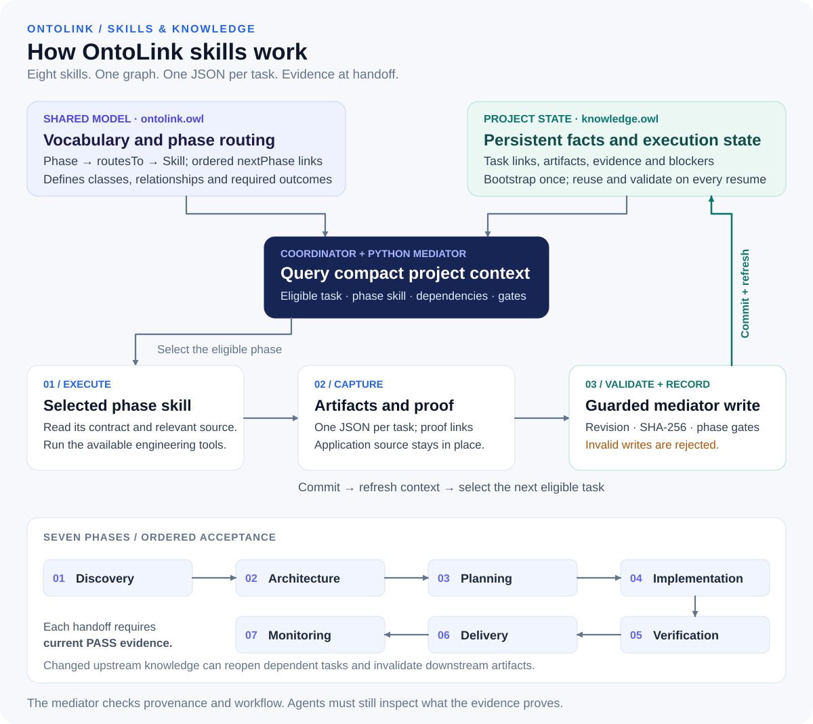
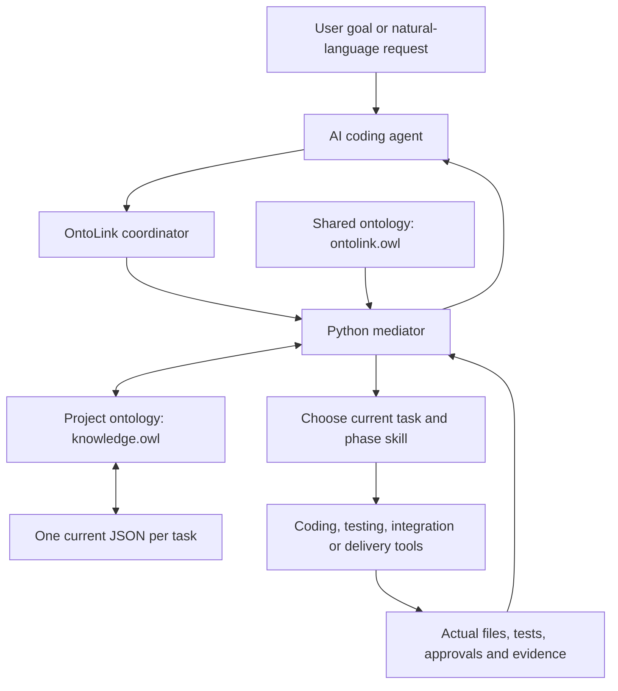
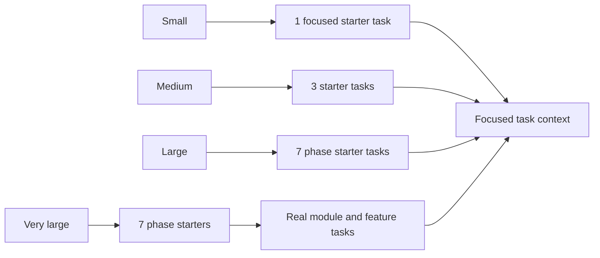

# OntoLink — Ontology-Guided Project Coordinator

**Coordinate AI-assisted work from a small idea to a large codebase — with one coordinator, a compact ontology, and one current JSON record per task.**

OntoLink is an **AI project-workflow coordinator**, not another code generator or a replacement for your coding agent. It connects project goals, tasks, dependencies, specialist skills, implementation artifacts, and verification evidence so work can be resumed **without repeatedly reading the whole repository or every past conversation**.

**For beginners and vibe coding:** describe what you want in natural language to an AI coding agent. OntoLink helps that agent discover, plan, implement, verify, and continue in an orderly way. You do not need to understand RDF or manually author JSON, but you still need an AI agent with the appropriate tools and must approve consequential changes.

**For experienced teams:** retain explicit dependencies, evidence-based completion gates, project history through current durable records, and small, focused context packets across sessions.

> **بالعربي:** OntoLink هو منسّق مهام ووكلاء للمشاريع البرمجية، مناسب حتى لمن يعمل بأسلوب *Vibe Coding* دون خبرة برمجية عميقة. يبدأ خفيفًا للمشاريع الصغيرة، ويتوسع حسب العمل الفعلي للمشاريع المتوسطة والكبيرة. لا يكرر ملفات المهام أو العلاقات، ولا يحفظ حدثًا جديدًا مع كل تحديث.

**Jump to:** [How it works](#how-ontolink-works) · [Project sizes](#one-coordinator-for-every-project-size) · [Install](#installation) · [Quickstart](#first-run-and-daily-work) · [Data model](#one-ontology-one-json-file-per-task) · [Agent prompts](#prompts-for-ai-coding-agents)

## Why OntoLink exists

A single natural-language request can require many connected actions: understanding requirements, choosing an architecture, changing files, running tests, handling blockers, getting approval, and deploying. Without coordination, an agent may skip dependencies, repeat explanations, lose decisions between sessions, or claim a task is complete before the evidence is checked.

OntoLink organizes **what should happen next, what it depends on, which specialist procedure is relevant, and what evidence is needed to finish**. The connected AI agent and its developer tools still perform the actual work.

| Without structured coordination | With OntoLink |
| --- | --- |
| Each session starts from a broad conversation | Resume from the active task and its direct dependencies |
| Every request may produce a long generic plan | Use the smallest useful workflow for the project |
| A task's facts appear in several documents | Keep one current task JSON with the latest update |
| Dependencies are buried in prose | Use unique, directed RDF relationships |
| “Done” may mean only “the agent said so” | Require current artifacts, proof and unblocked prerequisites |
| Huge projects invite huge prompts | Read focused context; index code optionally |

No fixed token-reduction or correctness gain is promised. The benefit is **selective context and guarded workflow**, measured per workload.

## Original project diagrams

These visual assets are preserved from the first README.


*Project knowledge connects the user's goal to selected context rather than requiring the entire project to be loaded into each prompt.*



*Coordinator, shared model, project state, seven specialist phases, artifacts and proof. In the current compact version, task details live in one JSON per task; ordinary writes update its latest state rather than appending automatic Event nodes or separate receipt files.*

## How OntoLink works



1. **Discover:** inspect the actual project and propose a proportional starting footprint.
2. **Select:** resolve the eligible task, its phase, direct dependencies, blockers, and relevant files.
3. **Execute:** load only the required phase skill and use the available engineering tools.
4. **Verify:** check current artifacts, tests, proof hashes, approvals and predecessor tasks.
5. **Record:** atomically update the canonical graph and the selected task's JSON snapshot, guarded by the observed revision.
6. **Resume:** retrieve fresh, bounded context and continue with the next eligible task.

The shared `skills/ontolink-skills/assets/ontolink.owl` defines vocabulary and phase routing. Every target project has its own `knowledge.owl` with project-specific facts. The Python mediator applies operational rules; the RDF/XML file is **not** an executable workflow or a general-purpose OWL reasoner.

## One coordinator for every project size

OntoLink examines the source-file footprint on **first bootstrap**. It avoids generated/dependency folders such as `.git`, `node_modules`, `.venv`, `dist`, `bin` and `obj`.

| Project footprint | Initial tasks | Intended approach |
| --- | --- | --- |
| **Small: up to 25 files** | **1** discovery starter | Keep setup and records minimal; add implementation/verification work only when actually needed |
| **Medium: 26–200 files** | **3** starters: discovery, implementation, verification | Track main deliverables, tests and real dependencies without boilerplate |
| **Large: over 200 files** | **7** phase starters | Coordinate discovery through monitoring; create focused additional tasks for actual modules and workstreams |
| **Very large / multi-module** | **7 starters, then as many real tasks as needed** | Decompose by workstream, maintain explicit dependencies and fetch one focused task at a time; enable optional source indexing if useful |

These are **initial scaffolding heuristics, not project complexity scores, task limits, or promises of automatic full decomposition**. Existing projects keep their state and tasks when reopened. A user or agent can add real tasks as the scope becomes known.



For a large repository, **many tasks do not mean many files loaded into each prompt**. The mediator returns the active task, its direct relationships and bounded task index; optional Project Intelligence can search a separate, rebuildable code index. This design supports large projects without copying full source, event history or every phase instruction into each task.

## The coordinator and its seven phases

**Eight bundled skills:** one coordinator (`ontolink-skills`) and seven on-demand procedures. The coordinator decides **which task and procedure** to use; the AI agent's engineering tools do **the implementation**.

| Order | Skill | Main question / outcome |
| --- | --- | --- |
| Coordinator | [ontolink-skills](skills/ontolink-skills/SKILL.md) | Which task, dependencies and evidence matter now? |
| 1 | [Discovery](skills/ontolink-skills/skills/ontolink-discovery/SKILL.md) | What does the user need? Requirements and acceptance criteria |
| 2 | [Architecture](skills/ontolink-skills/skills/ontolink-architecture/SKILL.md) | How should it work? Reviewed structure and contracts |
| 3 | [Planning](skills/ontolink-skills/skills/ontolink-planning/SKILL.md) | In what order? Scope, ownership, dependencies and blockers |
| 4 | [Implementation](skills/ontolink-skills/skills/ontolink-implementation/SKILL.md) | Build the change and preserve project conventions |
| 5 | [Verification](skills/ontolink-skills/skills/ontolink-verification/SKILL.md) | Do the relevant checks pass on the current artifact? |
| 6 | [Delivery](skills/ontolink-skills/skills/ontolink-delivery/SKILL.md) | Was the approved result released or handed off? |
| 7 | [Monitoring](skills/ontolink-skills/skills/ontolink-monitoring/SKILL.md) | What is observed, blocked or due for follow-up? |


This diagram is the **complete phase catalog**, not a rule to create seven task files for every small project. Phase acceptance rules apply to the actual tasks that exist. Other development skills and external tools are optional integrations, **not replacements for the coordinator**.

## One ontology, one JSON file per task

The data model intentionally avoids repeated text and duplicate relationship arrays.

```text
my-project/
├── knowledge.owl                      # One active project graph
├── .rule/
│   ├── ontolink.py                    # Installed project adapter
│   └── ONTOLOGY-FIRST.md              # Short project policy
├── .agents/skills/ontolink-skills/    # Coordinator with seven nested skills
└── .ontolink/
    └── tasks/
        ├── task-discover.json         # One current record for this task
        └── task-build.json            # One current record for this task
```

The `.ontolink/records`, `proofs`, `events` and `archive` folders are **virtual until needed**; no empty placeholder files or folders are required. Original code, test logs, generated outputs and proof files remain in their native project paths. Do **not** put helper Python scripts into `.ontolink`.

**Illustrative current task snapshot** (the mediator generates `revision`, `updatedAt`, and the record hash):

```json
{
  "formatVersion": 3,
  "id": "task-build",
  "type": "Task",
  "uri": "urn:ontolink:project:demo/task-build",
  "revision": 4,
  "updatedAt": "2026-11-25T10:00:00+00:00",
  "properties": {
    "title": "Implement project work",
    "phase": "urn:ontolink:build",
    "status": "RUNNING",
    "owner": "coordinator",
    "requiredKind": "implementation"
  },
  "relationships": {
    "belongsTo": ["urn:ontolink:project:demo"],
    "dependsOn": ["urn:ontolink:project:demo/task-discover"]
  },
  "files": [{ "path": "src/app.py" }],
  "lastUpdate": "Implementation updated; verification still pending."
}
```

- **One task = one current JSON file.** Extra task details—actors, artifacts, assessments, blockers, communications, contracts, decisions, evidence, files, requirements, test results, risks and recommendations—can be included **when relevant**. Empty sections are omitted.
- **One relationship location.** Resource links such as `dependsOn`, `usesArtifact`, `derivedFrom` and `belongsTo` live in `relationships`; scalar task state belongs in `properties`. Links are unique, not copied into two JSON sections.
- **One latest update.** `lastUpdate` and `updatedAt` describe the current state; normal writes do not create a new `Event` node, duplicate task JSON or per-revision receipt.
- **One canonical reference.** `knowledge.owl` keeps the task's routing projection, unique links, `taskRecord` path and `taskRecordHash` (SHA-256). The hash connects the graph to the task JSON and detects accidental out-of-band edits.
- **Evidence is not a claim.** `DONE` needs current `PASS` evidence, matching artifact/proof hashes, completed dependencies and resolved blockers. Agents must still judge whether a test actually proves the requirement.
- **Archive only when justified.** On defined compaction/size conditions, the runtime can checkpoint the ontology in `.ontolink/archive/`; it does not start a new independent graph automatically.

For the exact fields and guardrails, see the [task record contract](skills/ontolink-skills/references/record-contract.md) and [ontology-first policy](skills/ontolink-skills/.rule/ONTOLOGY-FIRST.md). Do not edit a generated task JSON by hand; record changes through the mediator so the graph hash and revision stay in sync.

## Installation

**Prerequisites:** Git, Python 3.10+, an existing target project directory, and an AI coding agent if you want natural-language-driven execution. Node.js/npm are optional for the Skills CLI method.

### Recommended: clone and integrate into a project

Clone the **distribution outside your target project's folder**:

```bash
git clone https://github.com/asgmodel/ontolink-skills.git /path/to/ontolink-distribution
python /path/to/ontolink-distribution/skills/ontolink-skills/scripts/project_setup.py --project /path/to/my-project
```

For Windows PowerShell (replace both locations with your real paths):

```powershell
git clone https://github.com/asgmodel/ontolink-skills.git C:\Projects\ontolink-distribution
python C:\Projects\ontolink-distribution\skills\ontolink-skills\scripts\project_setup.py --project "C:\Projects\my-project"
```

The installer copies the complete coordinator bundle, sets up `.rule/`, adds short managed pointers to `AGENTS.md` and `GEMINI.md`, and creates or validates the project's canonical state. It preserves unrelated project files and backs up managed replacements when appropriate.

To install an **existing development branch instead of `main`**, clone with `--branch BRANCH_NAME --single-branch`; the setup command is otherwise identical. A skill copied by this installer is not automatically registered in the separate npm Skills CLI lockfile.

### Optional: Skills CLI discovery

The first README also documented installing the coordinator with the community Skills CLI:

```bash
npx skills add asgmodel/ontolink-skills --skill ontolink-skills
```

This selects **the coordinator package**; its seven phase skills are bundled inside it. The CLI installation is separate from project-state initialization: run the package's `scripts/project_setup.py --project ...` against the actual target project to install OntoLink project rules and canonical state. Resolve the installed skill path for your chosen agent.

## First run and daily work

From the **target project root**, after project setup:

```bash
python .rule/ontolink.py start --root . --skill-root .agents/skills/ontolink-skills
python .rule/ontolink.py context --root . --skill-root .agents/skills/ontolink-skills
```

The first `start` returns a project-scale proposal and the currently eligible task. On later sessions it **reuses** the existing ontology; it does not reset completed work.

For focused inspection or recording, use the bundled mediator:

```bash
python .agents/skills/ontolink-skills/scripts/mediator.py context --state knowledge.owl --task task-discover --budget 4000
python .agents/skills/ontolink-skills/scripts/mediator.py validate --state knowledge.owl
```

To record only the **latest update** for a task, read the current project `revision` from `context` first, then send a single inline record; no extra payload JSON is needed:

```bash
python .rule/ontolink.py record --root . --skill-root .agents/skills/ontolink-skills --json '{"id":"task-discover","type":"Task","lastUpdate":"Reviewed requirements and source files"}' --expected-revision 0
```

**`0` is only an example for a newly initialized project.** On every subsequent write use the exact revision returned by the latest context. On conflict, re-query and reconcile; **do not force or resubmit a record already committed**. The installed adapter automatically validates and refreshes context after a successful write.

### Core CLI reference

| Command | What it does |
| --- | --- |
| `project_setup.py --project PATH` | Installs/updates coordinator integration and preserves existing state |
| `.rule/ontolink.py start` | Bootstraps or resumes the project and proposes its starting footprint |
| `.rule/ontolink.py context` | Validates and gets current task context |
| `.rule/ontolink.py record --json ... --expected-revision N` | Writes an inline record and refreshes context |
| `mediator.py bootstrap --root PATH` | Creates or reuses default `knowledge.owl` |
| `mediator.py init --project ID --title TEXT --output PATH [--scale small|medium|large]` | Explicitly creates a **new** state without overwriting an existing one |
| `mediator.py context --state PATH [--task ID] [--budget N]` | Selects focused project context |
| `mediator.py record --state PATH --json ... --expected-revision N` | Guarded atomic update without an extra payload file |
| `mediator.py validate --state PATH` | Checks structure, references, proof hashes and workflow gates |

For a project already using a **custom canonical state path**, use the same `--state path/to/existing.owl` in both setup and adapter commands. Never bootstrap a second `knowledge.owl` to bypass a validation error.

## Prompts for AI coding agents

The user can work in ordinary language; the coding agent executes the commands. This is the bridge to **vibe coding** without requiring the user to manually understand RDF, Python scripts or task JSON.

**Start a new project:**

> Install OntoLink Skills for this project using its current README. Inspect the actual project size, initialize or reuse `knowledge.owl`, and propose the smallest useful task plan. Ask me before external deployments or destructive changes. Use the selected phase skill and focus on one task at a time. Keep one current JSON per task, verify each result, and show me what was completed and what remains.

**Resume existing work:**

> Use `ontolink-skills`. Read the current project ontology and focused task record, inspect relevant source files, continue the next eligible task, run applicable tests, and record only the latest factual update with the correct revision. Do not reset state or duplicate tasks, evidence or relationships.

**Organize a very large repository:**

> Use OntoLink as the task coordinator for this repository. Identify real workstreams and dependencies, create only necessary tasks, choose one focused work packet at a time, and use the optional code index only if navigation needs it. Keep artifacts and proof in their real source locations; do not load the whole graph or entire codebase into every prompt. Validate completed work and report blockers.

These prompts assume an agent with read/write access and the tools needed to do the requested work; **a skill alone cannot code, test, deploy or monitor unattended**.

## Optional Project Intelligence for large projects

For big repositories, the optional Project Intelligence extension builds a **rebuildable code index**, separate from the authoritative task graph. It tracks file paths/hashes and lightweight symbols without copying complete source code into the ontology.

```bash
python .rule/ontolink.py start --root . --skill-root .agents/skills/ontolink-skills --index
python .agents/skills/ontolink-skills/scripts/project_intelligence.py search --root . --state knowledge.owl --query "authentication token validation"
```

Its generated index may live at `.ontolink/index/project-index.json`. This **optional cache is not another task record**, cannot mark tasks `DONE`, and can be rebuilt. The canonical `knowledge.owl` plus one JSON per task remain authoritative. Current retrieval uses local lexical BM25 plus graph-neighbor signals; embeddings and a hosted vector database are **not required**.

## Safe upgrades and continuity

Stop active writers, refresh the **distribution checkout**, then rerun setup against the existing project:

```bash
git -C /path/to/ontolink-distribution pull --ff-only origin main
python /path/to/ontolink-distribution/skills/ontolink-skills/scripts/project_setup.py --project /path/to/my-project
```

Setup validates current knowledge before replacement, archives affected managed files as needed, and preserves unrelated source, task JSON, evidence and canonical state. Existing task graph nodes lacking JSON remain readable and gain their linked JSON when updated. A failed compatibility check should be investigated; **do not delete `knowledge.owl` or `.ontolink/` to make the error disappear**.

If you intentionally installed a development branch, update **that same branch** rather than silently switching to `main`.

## Package layout and responsibilities

```text
ontolink-skills/
├── README.md
├── docs/assets/                     # Original diagrams and images
├── skills/ontolink-skills/
│   ├── SKILL.md                     # Coordinator instructions
│   ├── skills/                      # Seven bundled phase skills
│   ├── .rule/                       # Project policy and adapter
│   ├── scripts/                     # Installer, mediator, RDF store, retrieval
│   ├── references/                  # Contracts and focused technical guides
│   ├── assets/                      # Shared ontology, shapes and catalog
│   └── agents/                      # Agent-facing metadata
└── scripts/check.py                 # Distribution validation
```

| Component | Responsibility |
| --- | --- |
| `project_setup.py` | Safe installation, integration, backups and rollback |
| `mediator.py` | Bootstrapping, selection, dependency checks, revisions, evidence gates and atomic records |
| `rdf_store.py` | Constrained named-node RDF/XML reading and writing |
| `.rule/ontolink.py` | Project wrapper for start, context, record and refresh |
| `project_intelligence.py`, `project_indexer.py`, `retrieval.py` | Optional code navigation; not a second ontology |
| `scripts/check.py` | Distribution, RDF/SHACL and runtime regression checks |

### Validation

From the distribution checkout:

```bash
python -m pip install -r requirements-dev.txt
python scripts/check.py
```

Validation checks metadata, RDF/SHACL conformance, project integration, task and evidence rules, revisions, locks, and selected regressions. A passing workflow check **does not replace** testing the target application.

## Frequently asked questions

**Can someone without programming experience use it?** Yes, through a suitably equipped AI coding agent and natural-language requests. OntoLink coordinates the agent; human review is still necessary, especially for security, credentials, payments, deletions and deployments.

**Does a small project require seven tasks?** No. The first bootstrap proposes **one** starter task for a project with up to 25 inspected source files, and you add only work that is genuinely needed. The seven phase procedures remain available on demand.

**Can it handle very large or multi-module projects?** It can represent many real tasks and explicit dependencies, then retrieve focused context for one task. Its automatic size estimate is basic; complex decomposition and actual workstream management still depend on the agent's planning and available tools.

**Are all events and updates stored?** No. Ordinary task writes keep the **latest** update in one task JSON; automatic per-write Event nodes and receipt history are not added. Existing legacy graph data may still be present, and the runtime may preserve an ontology checkpoint when warranted.

**Is `.ontolink/` safe to delete?** No. The `tasks/` files are durable and hash-linked to `knowledge.owl`. An optional generated index can be rebuilt, but task records and referenced proofs must be preserved.

**Is it an autonomous background service or a replacement for GitHub/CI?** No. It runs when invoked by an agent or user. It can coordinate GitHub, CI and deployment **through separate connected tools and authorized actions**, but does not itself run a permanent watcher or claim external actions without evidence.

**Does OWL automatically save tokens or prevent hallucinations?** No. Limited context retrieval can reduce irrelevant text, and evidence gates can expose missing proof; actual token cost, implementation accuracy and test quality depend on the workload and agent.

## Technical references

- [Coordinator](skills/ontolink-skills/SKILL.md) and [ontology-first rules](skills/ontolink-skills/.rule/ONTOLOGY-FIRST.md)
- [Task record contract](skills/ontolink-skills/references/record-contract.md) and [execution contract](skills/ontolink-skills/references/execution-contract.md)
- [Knowledge model](skills/ontolink-skills/references/knowledge-model.md) and [lifecycle](skills/ontolink-skills/references/lifecycle.md)
- [Quickstart](skills/ontolink-skills/references/quickstart.md) and [Project Intelligence](skills/ontolink-skills/references/project-intelligence.md)
- [Validation and limitations](skills/ontolink-skills/references/validation.md)

**OntoLink's principle:** *A tiny project stays tiny. A complex project is coordinated through real dependencies. Every task has one current record, and every completed result needs evidence.*
