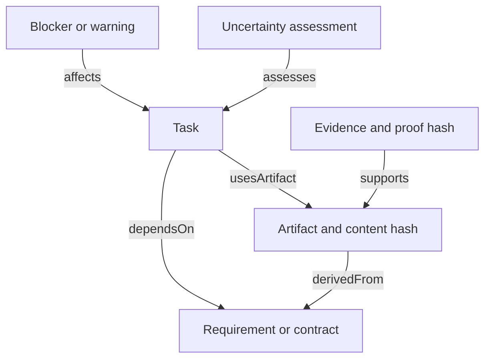

# Knowledge model

The schema uses `urn:ontolink:` identifiers. Routing is read live from OWL phase and skill individuals; project facts live in the canonical state graph. Each project node has an explicit `belongsTo` relationship. There is one Project per state file.

| Relationship | Purpose |
| --- | --- |
| `routesTo` | Select the phase workflow skill |
| `usesSkill` | Suggest an optional engineering adapter |
| `nextPhase` | Define the lifecycle order |
| `belongsTo` | Scope a state node to its project |
| `dependsOn` | Prerequisite and invalidation dependency |
| `usesArtifact` | Task consumption of a versioned artifact |
| `derivedFrom` | Knowledge and artifact derivation |
| `satisfies` | Connect an outcome to a requirement |
| `supports` | Evidence for a specific artifact |
| `affects` | Scope a blocker, warning or recommendation |
| `assesses` | Attach confidence or likelihood to its subject |
| `source`, `target` | Describe communication participants |

Dependency edges point from dependent to prerequisite in stored records. Invalidation follows reverse dependency reachability; declared cycles and dangling references are rejected.

| Measure | Meaning | Can mark work complete? |
| --- | --- | --- |
| Progress | Accepted DONE task weight divided by total task weight | No; derived from completion |
| Confidence | Evidence strength for a claim, with method and rationale | No |
| Likelihood | Probability judgment about a named event over a stated horizon | No |

Confidence and likelihood are disjoint OWL classes. Optional values lie in [0,1]; unknown is absence rather than zero. `calibrated` must be explicit and justified. Do not infer a probability from a confidence score. OWL declares the vocabulary; SHACL and runtime guards enforce bounded operational rules. No unrestricted OWL inference is performed by the runtime.
