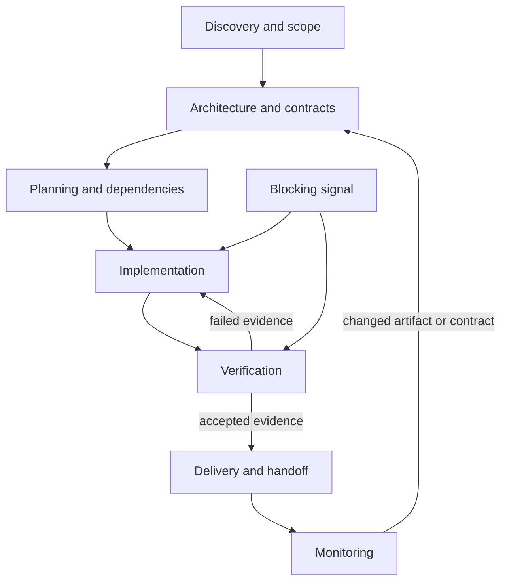

# Lifecycle and handoffs

Each phase owns a mandatory artifact kind. A caller cannot remove that outcome or jump phases by deleting a dependency. A phase can create finer-grained tasks, but all earlier phases must still close before later phase acceptance.

Discovery captures goals, actors, acceptance criteria and unresolved facts. Architecture establishes contracts and decisions. Planning makes work and dependencies explicit. Implementation uses actual stack-specific tools. Verification records current proof. Delivery performs only authorized external actions and records receipts. Monitoring checks observed conditions and reopens affected work; it is not an always-on service.

Changing a dependency may reopen already accepted work. Resolving a blocker removes the obstacle but does not manufacture completion or restore stale evidence. Generate a fresh context packet after every material state change.

Engineering adapters are optional installed capabilities; preserve the target project's native stack. Project startup, generated-file placement and refresh follow the [canonical rule](../.rule/ONTOLOGY-FIRST.md).
